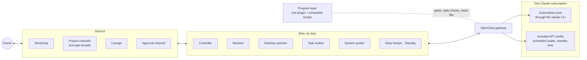

# SoloFleet

English | [简体中文](README.zh-CN.md)

**One Claude subscription, driving a small crew of bots that work in Discord.** Built on [OpenClaw](https://github.com/openclaw/openclaw). Shared as a personal showcase.

SoloFleet is an open-source setup for running a crew of AI agents in Discord on a single Claude subscription. It is built on OpenClaw and connects the subscription through the Claude Code command line (`claude -p`), so a multi-agent team runs on one plan instead of each agent paying per use through its own API key.

This repository holds everything needed to set the same thing up: the rules the bots follow, the plugin and scripts that keep the basics from slipping, the templates and scheduled-job prompts, and the documents that explain why it is put together this way.

## At a glance

| Item | Details |
|---|---|
| **What it is** | Open-source rules, one OpenClaw plugin and a set of scheduled scripts for a multi-agent crew that works in Discord |
| **Built on** | [OpenClaw](https://github.com/openclaw/openclaw) (gateway and plugin interface), Discord, and the Claude Code command line (`claude -p`) |
| **What you need** | A Mac that stays on (desktop operation is verified on macOS only), OpenClaw, Node.js 24.16 or later, Python 3, a Discord application and bot account for each bot, a Claude subscription, and the `claude` command line signed in |
| **Main features** | A reply card under every reply; requests to the owner in three tiers with a pending-decisions ledger; task completion gated by an independent audit; write-through records with a daily session reset; one desktop operator with a lock, a queue and owner-only approval cards |
| **License** | MIT |
| **Status** | A personal showcase. The author uses it day to day |

## What it is for

Two things get hard once you run more than a couple of agents:

1. **The bill stops making sense.** When every agent calls an API on its own, you find out what happened after the fact, in a console.
2. **One person's attention does not stretch.** A dozen agents can each ask a reasonable question, and together they bury you.

SoloFleet is one person's answer to both. The bots share a single Claude subscription, and every reply says what it used. The rules and the program layer are arranged so the owner hears from the crew rarely, and each time with a recommendation attached.

## The whole picture

- **How you talk to it**: the owner talks to the crew in Discord, the way you would lead a small team in a group chat; all the bots run inside one OpenClaw gateway.
- **Who does what**: each bot has one duty. The Controller takes requests, records decisions, hands work out and reports back; workers do the work in task threads; one Desktop operator is the only bot allowed to touch the screen; a Task auditor checks finished work and a System auditor checks the system itself.
- **How the subscription is used**: one Claude subscription, used to the full. Everyday conversation runs on the subscription itself, through the official `claude` command line (`claude -p` is its non-interactive form). If your plan also comes with API credits, they carry the scheduled audits and the standby bots, each with its own key, and stop when the credits run out, with no switch to paid usage.
- **What backs it up**: beside the gateway sits a program layer, one OpenClaw plugin plus scheduled scripts, that gates, checks every day and back-fills what must happen.

More in [Overview](docs/en/overview.md).

## How it differs from the usual setup

Most of the individual ideas here have been done by someone else, and [Why this design](docs/en/why-this-design.md) names them. What we have not found elsewhere is the set, fitted around one person running many bots.

- **One subscription for the whole crew, and every reply states what it cost.** Everyday work runs on the subscription; the API credits that come with it run the audits and the standby bots. Every reply carries a small reply card by default: which model, which pool, the reasoning effort and the files changed. To see how much of the subscription is left, install the macOS tool [CodexBar](https://github.com/steipete/CodexBar) and set two options (see the [Setup guide](docs/en/setup.md#6-external-dependencies-and-what-happens-without-them)).
- **Designed around one person's attention.** Bots that were not addressed stay quiet. Anything that needs a decision arrives merged, with a recommendation and numbered options, and is kept on a ledger so it cannot be lost. One report a day.
- **The program layer keeps the basics, without relying on the model to remember.** A task card cannot be marked done until an independent audit has passed and the result has not changed since. Auditors are held read-only. Judgement calls stay in the rules.
- **Write-through, then reset every day.** What the owner says is written into the records in the same turn, so sessions can be cleared daily and nothing needs explaining twice.
- **One bot on the desktop, with a lock, a queue and approval cards.** Payments, sending, deleting, submitting, uploading and installing wait for the owner's own click, one click per action. The safety document says plainly which cases the program can recognize and which it cannot.
- **No patches to OpenClaw.** This repository uses only official settings, the official plugin interface and one plugin of its own. It carries nothing that modifies the OpenClaw program itself.

## What a day looks like

You say what you want in the Workshop. The Controller restates anything complicated, proposes who should do it, and waits for one yes. After that the work happens in a project channel and you mostly see results. When something truly needs you, it comes as a short message with options; you answer with a number. In the evening there is one report.

[Daily use](docs/en/daily-use.md) walks through it.

## Getting started

Follow the [Setup guide](docs/en/setup.md). In short you need a Mac that stays on, OpenClaw, a Discord server with one bot account per duty, a Claude subscription, and the `claude` command line signed in on that machine. You sign in yourself, on your own machine; nothing in this repository handles or forwards your login.

Once it is running, see [Configuration](docs/en/configuration.md) to adapt it to your setup. To change the language the crew works in, see [Localization](docs/en/localization.md); the `locale` setting controls the fixed words the programs read and write, the folder names and the fixed reminders sent to the owner.

## What is in the repository

| Path | What it holds |
|---|---|
| `docs/` | These documents, in English and Chinese |
| `rules/` | The shared rules every bot follows, plus the part specific to each duty |
| `plugins/personal-inbox/` | The OpenClaw plugin: completion gate, auditor guard, desktop lock, approval handling, reply card, ledgers |
| `scripts/` | Scheduled scripts that run without a model: daily checks, reconciliation, quota handling, reminders |
| `config/` | One place for everything specific to a deployment, plus example OpenClaw settings |
| `templates/` | Task record, project entry, decision ledger and index templates |
| `jobs/` | Prompts for the scheduled jobs: daily and weekly system audit, daily patrol, diary |
| `personas/` | An empty persona template and one original example |
| `tests/` | Offline tests for the programs |
| `builder-tools/` | Optional tools for whoever maintains the system: a cross-vendor review script and two writing skills |

## Role-play is optional

In the reference deployment each bot speaks as a character, which makes a working day more fun. It is one way to use this, not a requirement: personas only shape how a bot talks, never what it concludes, and everything works without them. See [Roles](docs/en/roles.md).

## Common questions

### Can one Claude subscription run several AI agents?

Yes. The everyday bots share one subscription through the `claude` command line signed in on the same machine (non-interactive mode, `claude -p`). If your plan comes with API credits, the scheduled audits and the standby bots run on them with separate keys and stop when the credits run out, with no switch to paid usage. The subscription's own usage limits still apply: when one is reached the work pauses, and a script wakes it up again after the reset. See [Setup, step 2](docs/en/setup.md#2-connect-the-subscription) and [Why this design](docs/en/why-this-design.md).

### Can I use models from other providers?

The repository is written and tested for a Claude subscription: the rules, the configuration examples and the quota handling all assume it. OpenClaw itself can work with other providers, so swapping is possible in principle, but nothing here has been tried with them. One thing the setup guide advises against is logging OpenClaw in with a Google subscription account, because that provider's terms count it as a violation. See [Setup, step 2](docs/en/setup.md#2-connect-the-subscription).

### Is it safe to let a bot operate my Mac?

Only one bot can touch the screen, one thread at a time. Payment, sending to outside parties, permanent deletion, form submission, file upload and software installation wait for your own click on an approval card, one click per action. The program recognizes four kinds of such actions by itself; it cannot recognize a mouse click on a button, and that case rests on the bot's rule to stop first, backed by the lock and the card. [Safety](docs/en/safety.md) lists what is blocked, what is not, and what was and was not tested.

### Do I need to write code, and how long does setup take?

There is no code to write and nothing to `npm install`. Setup is still hands-on: you create the Discord bot accounts, fill in one configuration file, merge the example fragments into your OpenClaw configuration, generate each bot's rules with one command, create the scheduled jobs, and run the tests. We do not give a time estimate; it depends on how familiar you are with OpenClaw and Discord. The steps are in the [Setup guide](docs/en/setup.md).

### How is this different from Claude Code's built-in multi-agent features, or from agent frameworks?

Claude Code's subagents and teams also share one subscription, inside a coding session. General frameworks are libraries in which each agent usually brings its own API key. SoloFleet is a standing crew with fixed duties that one person talks to in Discord every day, and what it adds is around that: the reply card on every reply, rules built to spare the owner's attention, a program that will not let a task close without an audit, and approval cards for the desktop. Most of the pieces have precedents, and [Why this design](docs/en/why-this-design.md) names them.

### Is role-play required?

No. A persona only changes how a bot talks. Every duty works without one. See [Roles](docs/en/roles.md).

## Known limitations

What this setup has and has not been tried on.

1. **Desktop operation is verified on macOS only.** The desktop lock relies on macOS file locking. The rest is plain Node and Python and has not been run elsewhere. See the [Setup guide](docs/en/setup.md).
2. **Tested on a Claude subscription only.** Other providers have not been tried. The resume after a quota stop, the quota and login reminders and parts of the reply card are written against the Claude command line. See [Setup](docs/en/setup.md) and [Configuration](docs/en/configuration.md).
3. **The program cannot recognize a mouse click on a button.** For that case the Desktop operator stops first by rule, and the exclusive lock and the approval card stand behind it. See [Safety](docs/en/safety.md).
4. **It has not been built from scratch on a fresh machine.** The configuration examples were tidied up from the author's own deployment, so check the field names against your OpenClaw version. See [`config/examples/`](config/examples/README.md) and the [Setup guide](docs/en/setup.md).
5. **Some clock times are still inside scripts.** The daily reset notice, the audit cut-off and a few others are constants in the script files and are not yet configuration. See [Configuration](docs/en/configuration.md).
6. **Renaming the agents only reaches the rules for now.** A changed role table takes effect in the generated rule files; the plugin and the scripts still recognize the default agent IDs. See [Configuration](docs/en/configuration.md) and [Roles](docs/en/roles.md).
7. **One person uses it.** The author runs it alone, day to day. Use by several people or a team has not been tried.

This is the author's own personal project. The author is only a light user and has not tuned it for heavy development work, so sharing it is an experiment. Feedback is welcome and will be acted on.

## Credits

SoloFleet stands on OpenClaw, Discord and the Claude command line, and borrows ideas from a few books and projects. They are listed in [Credits](docs/en/credits.md).

## License and affiliation

MIT. See [LICENSE](LICENSE).

This is an independent personal project. It is not affiliated with or endorsed by OpenClaw, Discord or Anthropic.

Questions, corrections and "we do this differently" are all welcome. Open an issue.
