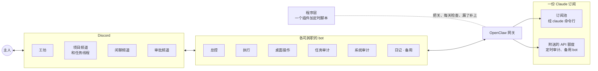

# SoloFleet

[English](README.md) | 简体中文

**一份 Claude 订阅，带一支在 Discord 里干活的 bot 小队。** 搭在 [OpenClaw](https://github.com/openclaw/openclaw) 上。个人展示用。

SoloFleet 是一套开源的搭法：用一份 Claude 订阅，在 Discord 里跑一支 AI agent 小队。它搭在 OpenClaw 上，订阅经 Claude Code 的命令行（`claude -p`）接进来，所以这支多智能体小队用的是同一份订阅，不是每个 agent 各拿一把密钥按量付费。

这个仓库放的是照着搭所需要的全部东西：bot 遵守的规则、保住基本功不走样的插件和脚本、各种模板和定时任务的指令，还有讲"为什么这样搭"的文档。

## 一眼看懂

| 项目 | 说明 |
|---|---|
| **是什么** | 一套开源的规则、一个 OpenClaw 插件和一批定时脚本，用来带一支在 Discord 里干活的多智能体小队 |
| **搭在什么上** | [OpenClaw](https://github.com/openclaw/openclaw)（网关和插件接口）、Discord、Claude Code 的命令行（`claude -p`） |
| **需要什么** | 一台常开的 Mac（桌面操作只在 macOS 上验过）、OpenClaw、Node.js 24.16 或更新、Python 3、每个 bot 一个 Discord 应用和 bot 账号、一份 Claude 订阅、登录好的 `claude` 命令行 |
| **主要功能** | 每条回复底下的回复附卡；给主人的请示分三档、配"等你定"台账；程序层接管必做的核对和把关（查格式、对账、独立审计通过才能结案），模型的注意力留给要判断的事；当轮写进记录、会话每天重置；一个桌面操作 bot，配独占锁、排队和只有主人能点的审批卡 |
| **许可证** | MIT |
| **状态** | 个人展示用。作者自己每天在用 |

## 它要解决什么

agent 一多，有两件事会变难：

1. **账单看不懂。** 每个 agent 各自调 API，花了多少要事后去后台看。
2. **一个人的注意力不够用。** 十几个 agent 每个都来问一句合情合理的话，加起来就把人淹了。

SoloFleet 是一个人对这两件事的回答。所有 bot 共用一份 Claude 订阅，每条回复都写明自己用了什么。规则和程序层的安排，让主人很少被叫到，每次被叫到都附着建议。

## 整体长什么样

- **怎么交流**：主人在 Discord 里跟小队说话，就像在群里带一支小团队；所有 bot 跑在同一个 OpenClaw 网关里。
- **怎么分工**：每个 bot 只管一件事——总控接需求、记决定、派活和汇报；执行 bot 在任务线程里干活；只有一个桌面操作 bot 能碰屏幕；任务审计核成果，系统审计核系统本身。
- **怎么用订阅**：一份订阅物尽其用。日常对话经官方 `claude` 命令行（非交互模式 `claude -p`）走订阅本身；如果你的方案附送 API 额度，就拿它跑定时审计和备用 bot，各用各的密钥，用完即停、不转付费。
- **怎么兜底**：网关旁边挂一层程序（一个 OpenClaw 插件加一批定时脚本），把关、每天核对、漏了补上这些杂活都由它接手，模型的注意力留给要判断的事。

详见[整体架构](docs/zh-CN/overview.md)。

## 和常见做法有什么不一样

这里的单个想法，多数别人都做过，[为什么这样搭](docs/zh-CN/why-this-design.md)里一一点了名。我们没在别处找到的，是把它们围着"一个人管很多 bot"配成一套。

- **一份订阅养整支小队，每条回复都亮明开销。** 日常走订阅，附送的 API 额度跑审计和备用 bot。每条回复底下默认带一张回复附卡，写明用了哪个模型、走的哪个池子、推理档位、改了哪些文件；如果想顺带看订阅还剩多少，装上 macOS 工具 [CodexBar](https://github.com/steipete/CodexBar) 再配两项即可（见[搭建指南](docs/zh-CN/setup.md#6-外部依赖缺了会怎样)）。
- **围着一个人的注意力来设计。** 没被叫到的 bot 不出声。要拍板的事合并成一条，带建议和编号选项，并且记在台账上丢不了。每天一份报告。
- **杂活交给程序，模型的注意力留给要判断的事。** 查格式、项目对账、请示漏记补登、限制派活途径和结案关口都在程序层里做，不靠模型硬记：没有独立审计通过、或者通过之后成果又改过，任务卡就标不成"完成"，审计角色被限制成只读。需要判断的事留给模型，留在规则里。
- **当轮写进记录，然后每天重置。** 主人说出口的事，在那一轮就写进记录；所以会话可以每天清空，什么都不用再解释一遍。
- **桌面只交给一个 bot，配独占锁、排队和审批卡。** 付款、对外发送、删除、提交、上传、安装，都等主人本人点卡，点一次放行一次。安全文档照实写了程序认得出哪几种、认不出哪几种。
- **不带改 OpenClaw 的补丁。** 这个仓库只用官方设置、官方插件接口和自己的一个插件，不带任何修改 OpenClaw 程序本体的东西。

## 一天用下来什么样

你在工坊里说要做什么。复杂的事，总控先复述一遍，提议谁来做，等你说一声"行"。之后活在项目频道里干，你多半只看到结果。真要你定的事，会是一条带选项的短消息，你回一个数字就行。晚上有一份报告。

[日常使用](docs/zh-CN/daily-use.md)里从头走了一遍。

## 怎么开始

照[搭建指南](docs/zh-CN/setup.md)做。简单说需要：一台常开的 Mac、OpenClaw、一个 Discord 服务器（每份职责一个 bot 账号）、一份 Claude 订阅，以及在这台机器上登录好的 `claude` 命令行。登录是你自己在自己机器上做的；这个仓库里没有任何东西经手或转发你的登录。

搭好之后，按[配置一览](docs/zh-CN/configuration.md)改成你自己的设置；如果要改小队的工作语言，看[换语言](docs/zh-CN/localization.md)（配置里的 `locale` 控制程序读写的固定词、目录名和发给主人的固定提醒）。

## 仓库里有什么

| 路径 | 放的是什么 |
|---|---|
| `docs/` | 这些文档，中英文各一套 |
| `rules/` | 所有 bot 共用的规则，加上每份职责专有的那一段 |
| `plugins/personal-inbox/` | OpenClaw 插件：结案关口、审计守门、桌面锁、审批处理、回复附卡、几本台账 |
| `scripts/` | 不调模型的定时脚本：每天的检查、对账、额度处理、提醒 |
| `config/` | 和具体部署有关的东西集中在一处，另有 OpenClaw 配置示例 |
| `templates/` | 任务记录、项目入口、决定账本、总索引的模板 |
| `jobs/` | 定时任务的指令：每天和每周的系统审计、每日巡查、日记 |
| `personas/` | 一份空的人设模板和一个原创示例 |
| `tests/` | 程序的离线测试 |
| `builder-tools/` | 给维护这套系统的人用的可选工具：一个跨厂商审计脚本和两份写作技能 |

## 角色扮演（小玩法）

我给日常打交道的 bot 都配了游戏角色的口吻。用起来不像在调度程序，更像一群熟人在群里干活。

- **各叫各的。** 《原神》的桑多涅叫我"旅行者"，《崩坏：星穹铁道》的银狼叫我"开拓者"，《绝区零》的 Fairy 一口一个"主人"，还全程用"您"。
- **各有各的腔调。** 桑多涅是总控，嘴上先嫌麻烦，转头就把事情安排得明明白白；我要是说她其实在关心人，她立刻否认。银狼管桌面，什么都当游戏打：付款、提交之前得停下等我点头，她管这叫"存档点"；干完交结果，她管这叫"晒结算"。
- **星核猎手三人组。** 银狼、卡芙卡、流萤在《崩坏：星穹铁道》里同属"星核猎手"，到我这儿也还是老搭档。卡芙卡和银狼不用商量就能配合上。银狼嘴上不饶人，却总劝流萤别把自己逼得太狠。卡芙卡会多照看流萤一点，但不替她拿主意。她俩要用屏幕，就在群里喊银狼；银狼回一句"排上了"，她们就等着，谁也不插队。
- **智识星神和它挑的天才们。** 博识尊是《崩坏：星穹铁道》里的智识星神，天才俱乐部的成员都是它挑的。我队里正好有三位：大黑塔、阮·梅、螺丝咕姆。博识尊在我这儿管任务审计，大家交上来的活都归它核，核到这三位也一样：不因为有渊源就放水，也不因为有旧账就加严。它从不寒暄，只提问、只报结论，没核到的就写"未知"。
- **不同游戏的不装熟。** 《原神》来的不认识《崩坏：星穹铁道》来的，谁也不替对方编来历，就当新同事处。

人设只管怎么说话。想自己配一套，从 [`personas/`](personas/) 的模板开始，再看[角色](docs/zh-CN/roles.md)。

文中角色归各自的游戏及其权利方所有，本项目与它们没有关联；仓库不含任何台词、官方设定原文和图片。

## 常见问题

### 一份 Claude 订阅能跑好几个 AI agent 吗？

可以。日常 bot 通过本机登录好的 `claude` 命令行（非交互模式 `claude -p`）共用同一份订阅；如果方案附送 API 额度，定时审计和备用 bot 会各用独立密钥走这份额度，用完就停、不转付费。订阅本身的限额照旧生效：撞到限额时任务会暂停，限额恢复后由脚本自动叫醒接着做。见[搭建指南第 2 步](docs/zh-CN/setup.md#2-接订阅)和[为什么这样搭](docs/zh-CN/why-this-design.md)。

### 能用别家的模型吗？

这个仓库是照着 Claude 订阅写的、测的：规则、配置示例和撞额度的处理都以它为前提。OpenClaw 本身可以接别家，所以原则上能换，但这里的东西没有在别家上试过。搭建指南里有一条明确不建议：别用 Google 的订阅账号登录 OpenClaw，那一家的条款把这算作违约。见[搭建指南第 2 步](docs/zh-CN/setup.md#2-接订阅)。

### 让 bot 操作我的 Mac，安全吗？

只有一个 bot 能碰屏幕，同一时间只给一个线程。付款、对外发送、永久删除、提交表单、上传文件、安装软件，都等你本人点审批卡，点一次放行一个动作。这类动作里有四种情形程序自己认得出；用鼠标点按钮它认不出，这种情形靠的是 bot 照规则先停，再由独占锁和审批卡托着。拦得住什么、拦不住什么、哪些测过哪些没测，都写在[安全设计](docs/zh-CN/safety.md)里。

### 要写代码吗？多久能搭起来？

不用写代码，也没有 `npm install` 这一步。但搭起来是要动手的：建 Discord 的 bot 账号，填一份配置文件，把示例片段并进你的 OpenClaw 配置，用一条命令生成各个 bot 的规则，建定时任务，跑一遍测试。要花多久我们不给数字，看你对 OpenClaw 和 Discord 有多熟。步骤在[搭建指南](docs/zh-CN/setup.md)。

### 和 Claude Code 自带的多 agent 功能、和别的 agent 框架，有什么不一样？

Claude Code 的子代理和团队功能也是共用一份订阅，用在一次编码会话里。通用的框架是库，每个 agent 通常自带 API 密钥。SoloFleet 是一支常驻的、各有职责的小队，一个人每天在 Discord 里跟它们说话；它多出来的东西都围着这件事：回复附卡、为省主人注意力而写的规则、不审过就结不了案的程序、桌面上的审批卡。这些零件多数有先例，[为什么这样搭](docs/zh-CN/why-this-design.md)里一一点了名。

### 角色扮演是必须的吗？

不是，它只是个小玩法。人设只管 bot 怎么说话，不改结论，也不改权限：该停下等确认的照停，该送审的照审，数字和决定一样要说清楚。不配人设，每份职责都照常干活。作者自己是怎么玩的，看上面的[角色扮演（小玩法）](#角色扮演小玩法)；想自己配，看[角色](docs/zh-CN/roles.md)。

## 已知不足

这套东西在哪些情况下试过、哪些没试过。

1. **桌面操作只在 macOS 上验过。** 桌面锁用的是 macOS 的文件锁。其余部分是普通的 Node 和 Python，没在别的系统上跑过。见[搭建指南](docs/zh-CN/setup.md)。
2. **只在 Claude 订阅上测过。** 换别家没试过。撞额度后的接续、额度和登录的提醒、回复附卡里的几处，都是照 Claude 命令行写的。见[搭建指南](docs/zh-CN/setup.md)和[配置一览](docs/zh-CN/configuration.md)。
3. **程序认不出用鼠标直接点按钮。** 这种情形靠桌面操作 bot 照规则先停，独占锁和审批卡在后面托着。见[安全设计](docs/zh-CN/safety.md)。
4. **没在一台全新的机器上从头搭过。** 配置示例是照作者自己的部署整理出来的，字段名请对照你的 OpenClaw 版本核一遍。见 [`config/examples/`](config/examples/README.zh-CN.md) 和[搭建指南](docs/zh-CN/setup.md)。
5. **有几处钟点还写在脚本里。** 每日重置通知、审计的截止时间等几处，是脚本文件里的常量，还没做成配置。见[配置一览](docs/zh-CN/configuration.md)。
6. **给 agent 改名目前只对规则生效。** 改了角色表，生成的规则文件会跟着变；插件和脚本认的仍是默认的 agent 编号。见[配置一览](docs/zh-CN/configuration.md)和[角色](docs/zh-CN/roles.md)。
7. **只有一个人在用。** 作者自己每天在用。多人、团队的场景没试过。

这是作者自用的个人项目。作者只是轻度使用者，没在重型开发场景里调过，开源出来也是一次尝试。欢迎反馈，会照着改。

## 借鉴与致谢

SoloFleet 站在 OpenClaw、Discord 和 Claude 命令行上面，还从几本书和几个项目里借了想法，都列在[致谢](docs/zh-CN/credits.md)里。

## 许可证和关系说明

MIT，见 [LICENSE](LICENSE)。

这是一个独立的个人项目，与 OpenClaw、Discord、Anthropic 没有隶属或背书关系。

欢迎提问、指正，也欢迎告诉我们"这件事我们是另一种做法"。开个 issue 就行。
