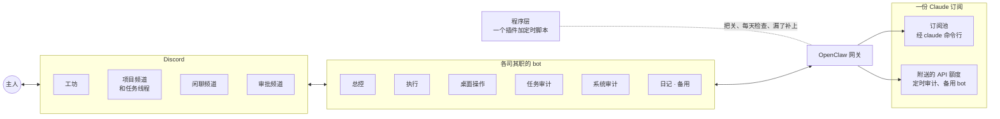

# SoloFleet

[English](README.md) | 简体中文

**一份 Claude 订阅，带一支在 Discord 里干活的 bot 小队。** 搭在 [OpenClaw](https://github.com/openclaw/openclaw) 上。个人展示用。

SoloFleet 是一套开源的搭法：用一份 Claude 订阅，在 Discord 里跑一支 AI agent 小队。它搭在 OpenClaw 上，订阅经 Claude Code 的命令行（`claude -p`）接进来，所以这支多智能体小队用的是同一份订阅，不是每个 agent 各拿一把密钥按量付费。

这个仓库放的是照着搭所需要的全部东西：bot 遵守的规则、保住基本功不走样的插件和脚本、各种模板和定时任务的指令，还有讲"为什么这样搭"的文档。

## 一眼看懂

| 项目 | 说明 |
|---|---|
| **是什么** | 一套开源的规则、一个 OpenClaw 插件和一批定时脚本，用来带一支在 Discord 里干活的多智能体小队 |
| **搭在什么上** | [OpenClaw](https://github.com/openclaw/openclaw)（网关和插件接口）、Discord、Claude Code 的命令行（`claude -p`） |
| **需要什么** | 一台常开的 Mac（桌面操作只在 macOS 上验过）、OpenClaw、Node.js 24.16 或更新、Python 3、每个 bot 一个 Discord 应用和 bot 账号、一份 Claude 订阅、登录好的 `claude` 命令行 |
| **主要功能** | 每条回复底下的用量小卡；给主人的请示分三档、配"等你定"台账；独立审计通过才能结案；当轮写进记录、会话每天重置；一个桌面操作 bot，配独占锁、排队和只有主人能点的审批卡 |
| **许可证** | MIT |
| **状态** | 个人展示用。作者自己每天在用 |

## 它要解决什么

agent 一多，有两件事会变难：

1. **账单看不懂。** 每个 agent 各自调 API，花了多少要事后去后台看。
2. **一个人的注意力不够用。** 十几个 agent 每个都来问一句合情合理的话，加起来就把人淹了。

SoloFleet 是一个人对这两件事的回答。所有 bot 共用一份 Claude 订阅，每条回复都写明自己用了什么。规则和程序层的安排，让主人很少被叫到，每次被叫到都附着建议。

## 整体长什么样

把图用话说一遍：主人在 Discord 里跟各个 bot 说话；所有 bot 都跑在同一个 OpenClaw 网关里；网关把一份 Claude 订阅用到物尽其用：日常的每一轮经 `claude` 命令行走订阅本身；订阅附送的 API 额度（如果你的方案带）也不闲着，拿去跑定时审计和备用 bot。网关旁边是一层程序，一个插件加一批定时脚本，负责检查、拦住和补上。

- 主人在 Discord 里跟小队说话，就像在群里跟团队说话。
- 每个 bot 只有一份职责。总控接需求、做记录、派活、汇报。执行 bot 在任务线程里干活。只有一个桌面操作 bot 可以动屏幕。任务审计核交上来的成果，系统审计核这套系统本身。
- 一份 Claude 订阅，物尽其用。日常对话走订阅本身，经官方的 `claude` 命令行（`claude -p` 就是这条路的非交互写法）。如果你的订阅方案还附送 API 额度，这份额度也不浪费：拿去跑定时审计和备用 bot，各用各的密钥，用完就停，不转付费。
- 旁边还有一层程序：一个 OpenClaw 插件加一批定时脚本，负责检查、拦住和补上那些必须发生的事。

详见[整体架构](docs/zh-CN/overview.md)。

## 和常见做法有什么不一样

这里的单个想法，多数别人都做过，[为什么这样搭](docs/zh-CN/why-this-design.md)里一一点了名。我们没在别处找到的，是把它们围着"一个人管很多 bot"配成一套。

- **一份订阅养整支小队，每条回复都写明用了什么。** 订阅本身跑小队的日常，订阅附送的 API 额度（如果你的方案带）跑定时审计和备用 bot，这份订阅里没有哪一块是闲着的。每条回复底下有一张小卡，默认就开着：哪个模型、走的哪个池子、推理档位、这一轮改了哪些文件。想在小卡上看到订阅还剩多少？装上 [CodexBar](https://github.com/steipete/CodexBar) 命令行（一个 macOS 应用），再在插件配置里设两项就有，步骤见[搭建指南](docs/zh-CN/setup.md#6-外部依赖缺了会怎样)。
- **围着一个人的注意力来设计。** 没被叫到的 bot 不出声。要拍板的事合并成一条，带建议和编号选项，并且记在台账上丢不了。每天一份报告。
- **程序层保基本功，不靠模型记得。** 没有独立审计通过、或者通过之后成果又改过，任务卡就转不成"完成"。审计角色被限制成只读。需要判断的事留在规则里。
- **当轮写进记录，然后每天重置。** 主人说出口的事，在那一轮就写进记录；所以会话可以每天清空，什么都不用再解释一遍。
- **桌面只交给一个 bot，配独占锁、排队和审批卡。** 付款、对外发送、删除、提交、上传、安装，都等主人本人点卡，点一次放行一次。安全文档照实写了程序认得出哪几种、认不出哪几种。
- **不带改 OpenClaw 的补丁。** 这个仓库只用官方设置、官方插件接口和自己的一个插件，不带任何修改 OpenClaw 程序本体的东西。

## 一天用下来什么样

你在工坊里说要做什么。复杂的事，总控先复述一遍，提议谁来做，等你说一声"行"。之后活在项目频道里干，你多半只看到结果。真要你定的事，会是一条带选项的短消息，你回一个数字就行。晚上有一份报告。

[日常使用](docs/zh-CN/daily-use.md)里从头走了一遍。

## 怎么开始

照[搭建指南](docs/zh-CN/setup.md)做。简单说需要：一台常开的 Mac、OpenClaw、一个 Discord 服务器（每份职责一个 bot 账号）、一份 Claude 订阅，以及在这台机器上登录好的 `claude` 命令行。登录是你自己在自己机器上做的；这个仓库里没有任何东西经手或转发你的登录。

然后看[可配置项](docs/zh-CN/configuration.md)，把它改成你自己的情况；小队用什么语言干活，看[换语言](docs/zh-CN/localization.md)：`locale` 决定程序按字面认和写的词，以及数据根里的文件夹名。

## 仓库里有什么

| 路径 | 放的是什么 |
|---|---|
| `docs/` | 这些文档，中英文各一套 |
| `rules/` | 所有 bot 共用的规则，加上每份职责专有的那一段 |
| `plugins/personal-inbox/` | OpenClaw 插件：结案关口、审计守门、桌面锁、审批处理、回复附卡、几本台账 |
| `scripts/` | 不调模型的定时脚本：每天的检查、对账、额度处理、提醒 |
| `config/` | 和具体部署有关的东西集中在一处，另有 OpenClaw 配置示例 |
| `templates/` | 任务记录、项目入口、决定账本、总索引的模板 |
| `jobs/` | 定时任务的指令：每天和每周的系统审计、每日巡查、日记 |
| `personas/` | 一份空的人设模板和一个原创示例 |
| `tests/` | 程序的离线测试 |
| `builder-tools/` | 给维护这套系统的人用的可选工具：一个跨厂商审计脚本和两份写作技能 |

## 角色扮演是可选的

参考部署里每个 bot 都按一个角色的口吻说话，干活的一天会有意思得多。这只是一种玩法，不是必须：人设只管 bot 怎么说话，不管它得出什么结论；不配人设一切照常。见[各职责说明](docs/zh-CN/roles.md)。

## 常见问题

### 一份 Claude 订阅能跑好几个 AI agent 吗？

在这套搭法里可以，而且要做的就是把这一份订阅用到物尽其用。日常的 bot 走订阅本身：OpenClaw 把它们的每一轮交给同一台机器上登录好的 `claude` 命令行，用的是非交互模式（`claude -p`）。同一份订阅附送的 API 额度（如果你的方案带）也派上用场：拿去跑定时审计和备用 bot，各用各的密钥，用完就停，不转付费。订阅本身的用量限制照旧：撞到限额时活会停下，限额恢复后由脚本叫回来接着做。见[搭建指南第 2 步](docs/zh-CN/setup.md#2-接订阅)和[为什么这样搭](docs/zh-CN/why-this-design.md)。

### 能用别家的模型吗？

这个仓库是照着 Claude 订阅写的、测的：规则、配置示例和撞额度的处理都以它为前提。OpenClaw 本身可以接别家，所以原则上能换，但这里的东西没有在别家上试过。搭建指南里有一条明确不建议：别用 Google 的订阅账号登录 OpenClaw，那一家的条款把这算作违约。见[搭建指南第 2 步](docs/zh-CN/setup.md#2-接订阅)。

### 让 bot 操作我的 Mac，安全吗？

只有一个 bot 能碰屏幕，同一时间只给一个线程。付款、对外发送、永久删除、提交表单、上传文件、安装软件，都等你本人点审批卡，点一次放行一个动作。这类动作里有四种情形程序自己认得出；用鼠标点按钮它认不出，这种情形靠的是 bot 照规则先停，再由独占锁和审批卡托着。拦得住什么、拦不住什么、哪些测过哪些没测，都写在[安全设计](docs/zh-CN/safety.md)里。

### 要写代码吗？多久能搭起来？

不用写代码，也没有 `npm install` 这一步。但搭起来是要动手的：建 Discord 的 bot 账号，填一份配置文件，把示例片段并进你的 OpenClaw 配置，用一条命令生成各个 bot 的规则，建定时任务，跑一遍测试。要花多久我们不给数字，看你对 OpenClaw 和 Discord 有多熟。步骤在[搭建指南](docs/zh-CN/setup.md)。

### 和 Claude Code 自带的多 agent 功能、和别的 agent 框架，有什么不一样？

Claude Code 的子代理和团队功能也是共用一份订阅，用在一次编码会话里。通用的框架是库，每个 agent 通常自带 API 密钥。SoloFleet 是一支常驻的、各有职责的小队，一个人每天在 Discord 里跟它们说话；它多出来的东西都围着这件事：每条回复的用量小卡、为省主人注意力而写的规则、不审过就结不了案的程序、桌面上的审批卡。这些零件多数有先例，[为什么这样搭](docs/zh-CN/why-this-design.md)里一一点了名。

### 角色扮演是必须的吗？

不是。人设只改变 bot 怎么说话，不配人设每份职责都照常干活。见[各职责说明](docs/zh-CN/roles.md)。

## 已知不足

这套东西在哪些情况下试过、哪些没试过。

1. **桌面操作只在 macOS 上验过。** 桌面锁用的是 macOS 的文件锁。其余部分是普通的 Node 和 Python，没在别的系统上跑过。见[搭建指南](docs/zh-CN/setup.md)。
2. **只在 Claude 订阅上测过。** 换别家没试过。撞额度后的接续、额度和登录的提醒、回复小卡里的几处，都是照 Claude 命令行写的。见[搭建指南](docs/zh-CN/setup.md)和[可配置项](docs/zh-CN/configuration.md)。
3. **程序认不出用鼠标直接点按钮。** 这种情形靠桌面操作 bot 照规则先停，独占锁和审批卡在后面托着。见[安全设计](docs/zh-CN/safety.md)。
4. **没在一台全新的机器上从头搭过。** 配置示例是照作者自己的部署整理出来的，字段名请对照你的 OpenClaw 版本核一遍。见 [`config/examples/`](config/examples/README.zh-CN.md) 和[搭建指南](docs/zh-CN/setup.md)。
5. **有几处钟点还写在脚本里。** 每日重置通知、审计的截止时间等几处，是脚本文件里的常量，还没做成配置。见[可配置项](docs/zh-CN/configuration.md)。
6. **给 agent 改名目前只对规则生效。** 改了角色表，生成的规则文件会跟着变；插件和脚本认的仍是默认的 agent 编号。见[可配置项](docs/zh-CN/configuration.md)和[各职责说明](docs/zh-CN/roles.md)。
7. **只有一个人在用。** 作者自己每天在用。多人、团队的场景没试过。

这是一个爱好者的个人项目：作者是轻度使用者，没有为重型开发场景调优过的经验，这次开源是一次尝试。非常欢迎反馈，之后会照着反馈继续改进。

## 借鉴与致谢

SoloFleet 站在 OpenClaw、Discord 和 Claude 命令行上面，还从几本书和几个项目里借了想法，都列在[致谢](docs/zh-CN/credits.md)里。

## 许可证和关系说明

MIT，见 [LICENSE](LICENSE)。

这是一个独立的个人项目，与 OpenClaw、Discord、Anthropic 没有隶属或背书关系。

欢迎提问、指正，也欢迎告诉我们"这件事我们是另一种做法"。开个 issue 就行。
